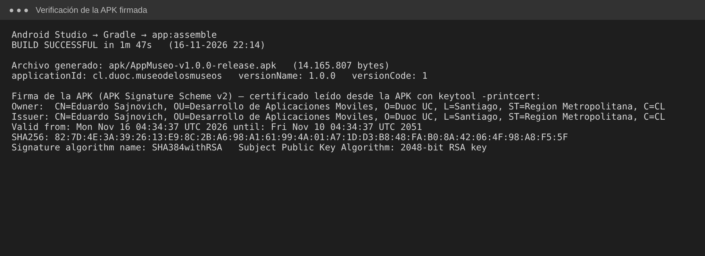
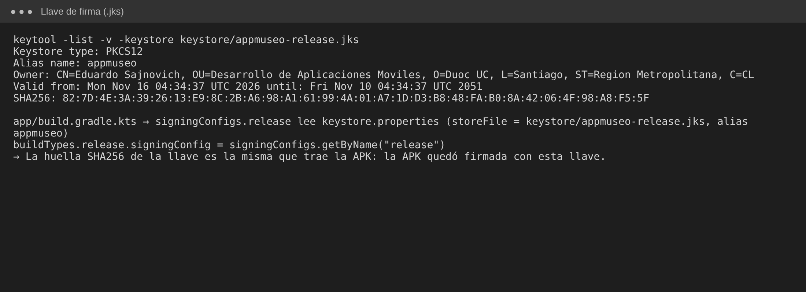

# AppMuseo · Museo de los Museos (DSY1105 · Evaluación Parcial 4)

MVP de la **aplicación móvil integrada para centralización comercial y Mapa de Museos Virtuales** del caso *Museo de los Museos*.
Desde la EA3 la app se conecta a un **backend de microservicios Spring Boot + MySQL** (repositorio **AppMuseo-Backend**) con **Retrofit**, y consume la API externa de **OpenStreetMap (Nominatim)**. Si el servidor no responde, sigue funcionando con la copia guardada en el teléfono.

- **Lenguaje:** Kotlin · **UI:** Jetpack Compose + Material 3 · **Arquitectura:** MVVM
- **Persistencia local:** Room (usuarios y solicitudes de cada usuario) + DataStore (sesión, preferencias y foto de perfil)
- **Roles:** Administrador, Investigador y Cliente (se elige al iniciar sesión)
- **Recursos nativos:** cámara, galería, lector QR, ubicación, mapa OpenStreetMap, notificaciones del sistema y vibración
- **Backend:** ms-usuarios, ms-catalogo y ms-pedidos (Spring Boot + MySQL), consumidos con Retrofit
- **Pruebas:** 104 pruebas JUnit, más pruebas Kotest + MockK y pruebas de interfaz con Compose UI Test
- **Entrega:** APK firmada con KeyStore propio (ver `docs/EA3_backend_y_apk.md`)

---

## Entrega Evaluación Parcial 4

### Nombre del proyecto
**AppMuseo · Museo de los Museos**: app móvil para descubrir museos virtuales de Iberoamérica, escanear sus códigos QR, comprar en la tienda del museo y seguir cada pedido con su boleta.

### Integrantes
| Integrante | Rol en el proyecto |
|---|---|
| Eduardo Sajnovich | Desarrollo completo: app Android, microservicios Spring Boot, pruebas, APK firmada y planificación en Trello |

### Funcionalidades
- Registro e inicio de sesión con tres roles (Administrador, Investigador, Cliente), contra **ms-usuarios**.
- Perfil editable (nombre, correo, contraseña y foto con la cámara).
- Mapa **OpenStreetMap** con los 14 museos, filtros por país o proyecto y museo más cercano por GPS.
- Ficha de cada museo con favoritos y **dirección real obtenida de la API externa Nominatim**.
- Escáner QR de museos (`MUSEO-5`) y productos (`MDM-001`).
- Catálogo con búsqueda y categorías, precios y stock desde **ms-catalogo**.
- Carrito con cotizador de envío (estándar o express, nacional o internacional, gratis sobre $50.000).
- Compra confirmada en **ms-pedidos**, que calcula los totales, descuenta el stock y entrega la boleta con neto e IVA.
- Seguimiento del pedido (Pendiente → Confirmada → Enviada → Entregada), anulación y "volver a comprar".
- Funciona sin conexión con la copia guardada en Room y avisa cuando el servidor no responde.

### CRUD desde la app
| Operación | Dónde | Endpoint |
|---|---|---|
| **Create** | Registro de cuenta · Confirmar compra | `POST /api/usuarios/registro` · `POST /api/pedidos` |
| **Read** | Mapa, catálogo, mis compras | `GET /api/museos` · `GET /api/productos` · `GET /api/pedidos?correo=` |
| **Update** | Editar perfil · Avanzar estado del pedido | `PUT /api/usuarios/{id}` · `PATCH /api/pedidos/{id}/avanzar` |
| **Delete** | Anular un pedido (vuelve el stock) | `DELETE /api/pedidos/{id}` |

### Endpoints utilizados

**Microservicios propios** (repositorio [AppMuseo-Backend](https://github.com/Sajnovich/AppMuseo-Backend), Spring Boot + MySQL):

| Microservicio | Método y ruta | Uso en la app |
|---|---|---|
| ms-usuarios :8081 | `POST /api/usuarios/login` | Inicio de sesión |
| | `POST /api/usuarios/registro` | Crear cuenta |
| | `GET /api/usuarios/correo/{correo}` · `PUT /api/usuarios/{id}` | Editar perfil |
| ms-catalogo :8082 | `GET /api/museos` | Mapa y lista de museos |
| | `GET /api/productos` | Catálogo |
| ms-pedidos :8083 | `POST /api/pedidos` | Confirmar compra |
| | `GET /api/pedidos?correo=` | Mis compras |
| | `PATCH /api/pedidos/{id}/avanzar` | Seguimiento |
| | `DELETE /api/pedidos/{id}` | Anular pedido |

**API externa:** OpenStreetMap **Nominatim**, consumida con Retrofit.

| Método y ruta | Uso en la app |
|---|---|
| `GET https://nominatim.openstreetmap.org/reverse?lat=&lon=&format=jsonv2` | Dirección real del museo en su ficha |

### Pasos para ejecutar
1. **Base de datos:** en `AppMuseo-Backend` corre `./levantar-bd.sh`, que enciende MySQL en Docker.
2. **Microservicios:** en `AppMuseo-Backend` ejecuta `CatalogoApplication`, `UsuariosApplication` y `PedidosApplication`. Puedes revisarlos en `http://localhost:8082/swagger-ui.html`.
3. **App:** abre este proyecto en Android Studio, espera el Gradle Sync y presiona **Run ▶** en un emulador. El emulador llega al computador por `10.0.2.2`.
4. **Cuentas de prueba:** `estudiante@museo.cl` / `duoc2026` · `admin@museo.cl` / `museo123` · `investigador@museo.cl` / `inves2026`.
5. **Pruebas y cobertura:** `./gradlew reporteCobertura`. El reporte queda en `app/build/reports/jacoco/reporteCobertura/html/index.html`.
6. **APK firmada:** `./gradlew assembleRelease`. El archivo queda en `app/build/outputs/apk/release/AppMuseo-v1.0.0-release.apk`, y una copia lista para instalar está en `apk/`.

### APK firmado y llave (.jks)
- **Llave:** `keystore/appmuseo-release.jks` (alias `appmuseo`, RSA 2048, válida hasta 2051).
- **Configuración:** `keystore.properties` y `signingConfigs` en `app/build.gradle.kts`.
- **APK:** `apk/AppMuseo-v1.0.0-release.apk`.

| APK firmado (verificación de la firma) | Llave .jks |
|---|---|
|  |  |

---

## 1. Cómo abrirla y ejecutarla

1. Descomprime el proyecto.
2. En Android Studio: **File → Open** y elige la carpeta `AppMuseo` (la que contiene `settings.gradle.kts`).
3. Espera a que termine el **Gradle Sync** (la primera vez descarga dependencias, necesita internet).
4. Elige un emulador (Device Manager) y presiona **Run ▶**.

**Usuarios de prueba** (en el login primero se elige el tipo de cuenta y luego aparece su usuario de prueba):

| Rol | Correo | Contraseña |
|---|---|---|
| Administrador | `admin@museo.cl` | `museo123` |
| Investigador | `investigador@museo.cl` | `inves2026` |
| Cliente | `estudiante@museo.cl` | `duoc2026` |

Si eliges un tipo de cuenta que no corresponde al usuario, la app no deja entrar y lo avisa.
También puedes crear una cuenta nueva con **"Crear cuenta"** (queda como Cliente): se guarda en Room
y la contraseña se guarda cifrada con SHA-256, nunca en texto plano. Las cuentas de prueba también se copian
a Room la primera vez, por eso se pueden editar desde *Perfil → Mis datos personales*.

> Si ya tenías instalada una versión anterior, la base de datos se reinicia sola (versión 4). Ante cualquier error raro, desinstala la app del emulador y vuelve a ejecutarla.

### Ejecutar las pruebas unitarias
- Clic derecho en `app/src/test/java/com/example/appmuseo` → **Run 'Tests in appmuseo'**, o
- En la terminal de Android Studio: `./gradlew test` (Windows: `gradlew test`).

---

## 2. Estructura de carpetas (MVVM, Guías 7, 9, 10 y 11)

```
app/src/main/java/com/example/appmuseo/
├── MainActivity.kt          → aplica el tema y arranca AppNavigation
├── model/                   → Producto (ProductoFisico / Curso), Museo, Zona, UiStates, ResultadoLogin…
├── data/
│   ├── SesionDataStore.kt   → DataStore Preferences (sesión, notificaciones)
│   └── local/               → Room: SolicitudEntity, UsuarioEntity, sus DAO y AppDatabase
├── repository/              → origen de datos SIMULADO (aquí entra Retrofit en la Unidad 3)
├── utils/                   → lógica pura: Validaciones, CotizadorEnvio, Distancia, Seguridad, Formato…
│                              y recursos nativos: Notificaciones, UbicacionUtils, ImagenUtils
├── navigation/              → Screen (rutas), NavigationEvent, AppNavigation (NavHost)
├── viewmodel/               → un ViewModel por funcionalidad (StateFlow)
└── ui/
    ├── theme/               → colores, tipografía y tema Material 3 (claro/oscuro)
    ├── utils/               → WindowSizeUtils (pantallas Compact / Medium / Expanded)
    ├── components/          → reutilizables: CampoTexto, DialogoConfirmacion, TarjetaProducto, Avatares, MuseoVisual, barras…
    └── screen/              → 20 pantallas
app/src/main/res/drawable-nodpi/ → ilustraciones de los productos (WebP)
app/src/test/…               → pruebas unitarias
```

**Flujo MVVM:** la *pantalla* (View) solo dibuja el estado y avisa eventos → el *ViewModel* aplica la lógica y actualiza un `StateFlow` → el *Repository* entrega los datos (hoy simulados, mañana desde el backend).

---

## 3. Qué cubre del caso

| Requerimiento del caso | Dónde está |
|---|---|
| Pantalla de carga y bienvenida | `CargaScreen` (logo grande → chico, barra y rebote) y `BienvenidaScreen` ("Crear cuenta" / "Ya tengo cuenta") |
| Inicio de sesión por rol | `LoginScreen` (Administrador, Investigador, Cliente) |
| Panel principal | `HomeScreen`: saludo, accesos rápidos, sección Explora, destacados y barra inferior |
| Catálogo unificado con imágenes (merch, conservación, publicaciones, cursos) | `CatalogoScreen`, `TarjetaProducto` (ilustración de cada producto), `CatalogoRepository` |
| Detalle con cantidad y disponibilidad | `DetalleProductoScreen` |
| Carrito con datos calculados | `CarritoScreen`: subtotal, envío según destino y tipo (Estándar / Express) y total; `ResumenCompra` |
| Resumen de compra antes de confirmar | `SolicitudScreen` (datos) → `ResumenCompraScreen` (productos + envío = total) |
| Historial de compras de cada usuario | Room: `SolicitudEntity.correoUsuario`, `MisSolicitudesScreen`; cada pedido abre `DetallePedidoScreen` con las pestañas **Seguimiento** (Pendiente → Confirmada → Enviada → Entregada) y **Boleta** (detalle con neto, IVA y total; se puede compartir) |
| Editar perfil (correo y contraseña) y foto | `EditarPerfilScreen`, `PerfilScreen`; la foto se guarda y se mantiene al cerrar la app |
| Favoritos | `FavoritosScreen` (museos y recursos) |
| Notificaciones dentro de la app | `NotificacionesScreen` con filtros por tipo |
| Cotizador de envío nacional e internacional | `CotizadorEnvio` (reglas), `CotizadorScreen` |
| Mapa de museos virtuales de Iberoamérica | `MapaMuseosScreen` (mapa real de OpenStreetMap con osmdroid, sin API key, filtros Todos / País / Proyecto, tarjeta del museo y "museo más cercano a mí") |
| Ficha de cada museo y lista completa | `DetalleMuseoScreen` (descripción, etiquetas, calificación, proyecto virtual, favoritos, cómo llegar) y `MuseosScreen` (buscador y filtro) |
| Lectura de códigos con cámara | `EscanerScreen`: al tocar "Escáner QR" se abre directo la cámara (Google Code Scanner). El QR `MUSEO-1` … `MUSEO-14` abre la ficha del museo y `MDM-001` … el producto; pantalla "¡Código identificado!" |
| Persistencia local de estados esenciales | DataStore (sesión) + Room (solicitudes) |
| Notificaciones push simuladas | Notificación local del sistema (`Notificaciones`) + aviso animado en la app (`NotificacionSimulada`); se activan/desactivan en Perfil |
| Registro de usuarios | `RegistroScreen` → `AuthRepository.registrar()` → Room (`UsuarioEntity`) |
| Accesibilidad básica | `contentDescription`, filas clickeables completas, textos en `sp`, aviso con `liveRegion`, tema con buen contraste |
| Datos sintéticos (Leyes 21.719 y 19.628) | Todos los productos, museos y usuarios son ficticios |

## 4. Qué se usó de cada guía

| Guía | Tema | Dónde |
|---|---|---|
| 2–3 | Null safety, `when`, colecciones (`filter`, `map`, `chunked`) | `CotizadorViewModel`, `UiStates`, `Formato`, `HomeScreen` |
| 4 | POO: herencia, clases abstractas, polimorfismo, control de errores (`try/catch`, `require`) | `Producto` → `ProductoFisico` / `Curso`, `Screen.construirRuta()`, `CotizadorEnvio` |
| 5 | Corrutinas, `suspend`, `delay`, `sealed class ResultadoLogin` | `AuthRepository`, `LoginViewModel` |
| 7 | Estructura MVVM | Carpetas del proyecto |
| 8 | Text, Button, Image, Column, Row, Modifier, Scaffold | Todas las pantallas |
| 9 | Window Size Classes | `WindowSizeUtils`, Catálogo (2/3/4 columnas) |
| 10 | `sealed class Screen` (rutas con argumentos), `NavigationEvent`, `MainViewModel`, TopAppBar, NavigationBar | `navigation/`, `Barras.kt` |
| 11 | UiState + Errores, `validarFormulario()`, `isError` / `supportingText`, ViewModel compartido | Login, Registro, Editar perfil, Solicitud, Cotizador y Escáner |
| 12 | `rememberSaveable`, `derivedStateOf`, `animateColorAsState`, `AnimatedVisibility`, `AnimatedContent`, transiciones, DataStore | Carga, Carrito, Perfil, Mis solicitudes, navegación |
| 13 | Cámara y galería, FileProvider, permisos en tiempo de ejecución, `ImagenInteligente` | Perfil, Escáner, Mapa (ubicación) |
| EA2 | Room | `data/local/` |

---

## 5. Recursos nativos del dispositivo

Todos los permisos "peligrosos" se piden **en el momento en que se necesitan** (no al abrir la app) y,
si el usuario dice que no, la app sigue funcionando y le explica qué pasó.

| Recurso | Para qué se usa | Permiso y manejo seguro | Archivo |
|---|---|---|---|
| Cámara | Foto de perfil (se copia a la carpeta privada de la app y su ruta queda en DataStore, por usuario) y foto del producto | La foto la toma la app de Cámara (`TakePicture`) en un `Uri` de `FileProvider`; **no** se declara `CAMERA` (si se declarara sin concederlo, Android bloquearía la cámara); `<queries>` para encontrar la app | `BotonesCamaraGaleria.kt`, `ImagenUtils.kt` |
| Galería | Elegir foto de perfil | Selector de fotos `PickVisualMedia`: sin permisos de almacenamiento; si cancela, no pasa nada | `BotonesCamaraGaleria.kt` |
| Ubicación | "Museo más cercano a mí" en el mapa | Solo ubicación **aproximada** (`ACCESS_COARSE_LOCATION`); sin permiso o sin señal se usa Santiago como referencia y se avisa | `UbicacionUtils.kt`, `MapaMuseosScreen.kt` |
| Notificaciones | Avisar cuando una solicitud se registra o cambia de estado | `POST_NOTIFICATIONS` (Android 13+) pedido al confirmar una solicitud o al activarlas en Perfil; sin permiso, el aviso se ve dentro de la app | `Notificaciones.kt`, `SolicitudViewModel.kt` |
| Vibración | Confirmar físicamente "agregar al carrito" | Retroalimentación háptica de Compose, no requiere permiso | `TarjetaProducto.kt`, `DetalleProductoScreen.kt` |
| Lector QR / código de barras | Escanear el QR de un museo (`MUSEO-n`) o el código de un producto (QR y CODE-128) | Google Code Scanner: Google Play services abre su propia cámara, la app no pide permiso; si se cancela, se avisa | `EscanerScreen.kt` |
| App de mapas | Abrir un museo en Google Maps u otra | `Intent` implícito con `try/catch` si no hay app instalada | `MapaMuseosScreen.kt` |

---

## 6. Programación orientada a objetos en el proyecto

| Concepto | Dónde se aplica |
|---|---|
| **Herencia + clase base abstracta** | `sealed class Producto` con miembros `abstract`; `ProductoFisico` y `Curso` heredan de ella |
| **Polimorfismo** | `limiteCompra()`, `disponibilidad()` y `etiquetaAccion()` responden distinto según el tipo: el carrito y las tarjetas no preguntan "¿es un curso?", solo llaman al método |
| **`when` exhaustivo sobre subclases** | `DetalleProductoScreen` muestra stock/peso para `ProductoFisico` y cupos/modalidad para `Curso` |
| **Sobrescritura (`open` / `override`)** | `Screen.construirRuta()` es `open`; `Screen.Detalle` la sobrescribe para insertar el id del producto |
| **Jerarquías cerradas para resultados** | `ResultadoLogin`, `ResultadoRegistro`, `NavigationEvent` (`sealed class`) |
| **Interfaces** | `UsuarioDao` y `SolicitudDao`: Room genera la implementación real y las pruebas usan `FakeUsuarioDao`; `AuthRepository` funciona igual con cualquiera de las dos |
| **Herencia de clases del framework** | Cada ViewModel hereda de `ViewModel` / `AndroidViewModel`; `AppDatabase` hereda de `RoomDatabase` |
| **Encapsulamiento** | `MutableStateFlow` privado y `StateFlow` público de solo lectura en todos los ViewModels; regla de negocio en `init { require(...) }` de `ProductoFisico` |
| **Objetos únicos (`object`)** | `Validaciones`, `CotizadorEnvio`, `Distancia`, `Seguridad`, `Notificaciones` |

---

## 7. Cómo se cubre cada criterio de la rúbrica

| Indicador | Evidencia en la app |
|---|---|
| **IE 2.1.1** Interfaz estructurada y navegación fluida | Jerarquía clara: Bienvenida → login por rol → Inicio con barra inferior y accesos rápidos; compra en 3 pasos (Carrito → Datos → Resumen); `TopAppBar` con volver; estados vacíos con acción ("Explorar catálogo"); confirmación antes de acciones que no se deshacen (`DialogoConfirmacion`); diseño adaptable (Window Size Classes) |
| **IE 2.1.2** Formularios con validación visual por campo | Login, Registro (con lista de campos obligatorios), Editar perfil, Solicitud, Cotizador y búsqueda del Escáner usan `CampoTexto`: ícono por campo, error en rojo con ícono y mensaje debajo, check verde cuando el dato es válido, textos de ayuda y teclado adecuado |
| **IE 2.2.1** Validaciones desacopladas de la UI | Todas las reglas están en `utils/Validaciones.kt` (Kotlin puro, probado con JUnit); los ViewModels guardan los errores en el `UiState` y la pantalla solo los dibuja |
| **IE 2.2.2** Animaciones con propósito | Logo de carga que se achica y rebota, tarjetas que entran una tras otra, línea del escáner, check con rebote, corazón que late, línea de tiempo del pedido, transiciones entre pantallas, `animateItem` al filtrar o eliminar, cantidad y total del carrito con `AnimatedContent`, avisos con `AnimatedVisibility`, colores de estado con `animateColorAsState`, marcador del mapa con `animateDpAsState`, logo de carga |
| **IE 2.3.1** Clases, herencia y polimorfismo | Ver sección 6 |
| **IE 2.3.2** GitHub y Trello | Ver sección 8 |
| **IE 2.4.1** Recursos nativos seguros y coherentes | Ver sección 5 |

---

## 8. Flujo de trabajo (GitHub + Trello)

- **Trello:** tablero con las columnas *Por hacer → En progreso → En revisión → Listo*. Cada tarjeta corresponde a un *issue* de GitHub.
- **Issues:** cada funcionalidad o corrección tiene su issue con la descripción y los criterios para darla por terminada.
- **Ramas:** se trabaja en ramas `feature/...` (funcionalidades), `fix/...` (correcciones) y `docs/...` (documentación); `main` queda siempre estable.
- **Integración:** cada rama se integra a `main` con un commit de merge (`--no-ff`), así el historial muestra cada parte por separado.
- **Correcciones del profesor por partes:** `feature/bienvenida-login-roles`, `feature/dashboard`, `feature/museos-y-qr`, `feature/compra-y-envio` y `feature/perfil-e-historial`.
- **Commits:** pequeños y descriptivos, en español.

---

## 9. Unidad 3: backend, Retrofit y APK firmada

| Antes (EA2) | Ahora (EA3) |
|---|---|
| `AuthRepository.USUARIOS_PRUEBA` + usuarios en Room | `POST /api/usuarios/login` y `/registro` en ms-usuarios (BCrypt); Room queda como copia sin conexión |
| `CatalogoRepository` y `MuseoRepository` con listas en código | `GET /api/productos` y `GET /api/museos` en ms-catalogo; la lista local es el respaldo |
| Compras solo en Room | `POST /api/pedidos` en ms-pedidos: el servidor calcula precios, envío, neto e IVA y descuenta stock |
| "Avanzar estado" solo en el teléfono | `PATCH /api/pedidos/{id}/avanzar` en el servidor |
| Ficha del museo con ciudad y país | Además, dirección real desde la API externa de OpenStreetMap (Nominatim) |

Para levantar el backend, revisa el README de **AppMuseo-Backend**. El detalle de Retrofit, las pruebas y la APK firmada está en [`docs/EA3_backend_y_apk.md`](docs/EA3_backend_y_apk.md).

---

## 10. Problemas comunes

- **"Unsupported class file major version" al sincronizar:** en *Settings → Build, Execution, Deployment → Build Tools → Gradle*, elige como *Gradle JDK* la versión 17 o 21.
- **Android Studio ofrece actualizar AGP:** puedes aceptar o ignorar; el proyecto funciona con la versión incluida.
- **Cámara en el emulador:** la cámara virtual funciona, pero en el Escáner también están los botones *Simular QR de museo* y *Simular producto*, y un campo para escribir el código (ej. `MUSEO-5` o `MDM-001`).
- **"Museo más cercano" siempre dice "desde Santiago" en el emulador:** el emulador no tiene ubicación guardada.
  Abre los *Extended controls* (botón ⋯) → *Location*, elige un punto y presiona *Set location*; luego abre Google Maps una vez y vuelve a la app.
- **No llegan notificaciones:** revisa que estén activadas en *Mi perfil* y que hayas aceptado el permiso (Android 13+). También se pueden activar en *Ajustes → Apps → AppMuseo → Notificaciones*.
